# LLMPanel

**An open-source control panel for self-hosted LLM inference.** Point it at a GPU
server or your own cloud GPU account, pick a model, and get an OpenAI-compatible
endpoint — with API keys, usage analytics and a chat playground — without writing
a Dockerfile or an nginx config.

Think Coolify, but for model inference.

[](https://github.com/LLMPanel/llmpanel-oss/actions/workflows/ci.yml)
[](LICENSE)
[](https://github.com/LLMPanel/llmpanel-oss/releases)

```bash
curl -fsSL https://raw.githubusercontent.com/LLMPanel/llmpanel-oss/master/install.sh | sudo bash
```

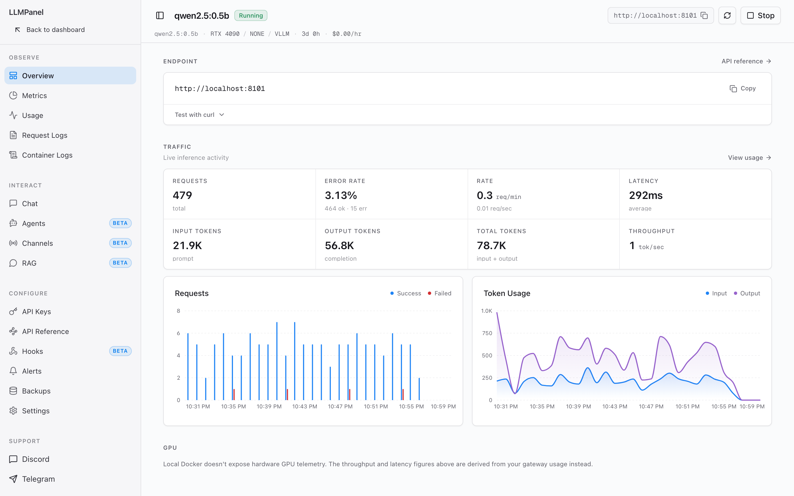

<sub>Screenshots are from a demo install with sample data.</sub>

---

- [What you get](#what-you-get)
- [Getting started](#getting-started)
- [Configuration](#configuration)
- [Before you expose it to the internet](#before-you-expose-it-to-the-internet)
- [Development](#development)
- [Architecture](#architecture)
- [Security](#security)
- [Contributing](#contributing) · [License](#license)

## What you get

### Deploy a model in four steps

Choose where it runs, pick a model from the registry, choose a quantization and a
GPU, and deploy. The panel returns immediately and provisions in the background:
weights download, the container starts, and a health check gates it live, with
progress streamed to the dashboard.

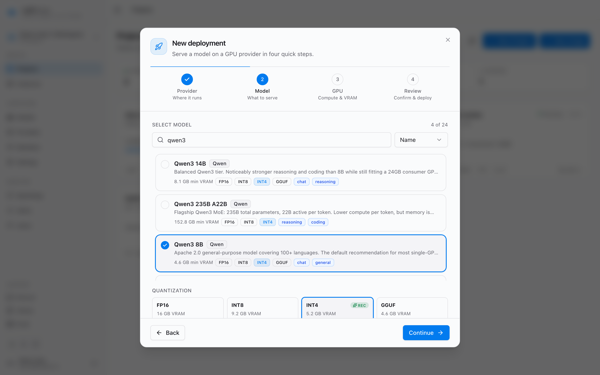

### Keep every deployment in one place

Each deployment is a project with its own endpoint, keys, logs and analytics. The
overview shows what is running, deploying, failed or stopped.

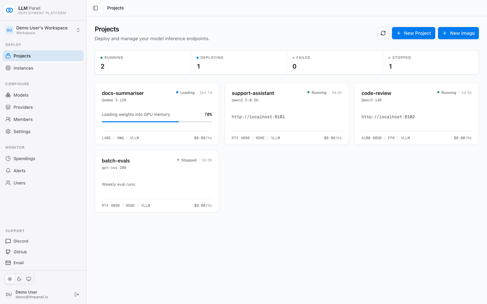

### Talk to it before you ship it

The chat playground streams from the deployment and reports tokens per second,
time to first token and total latency for every reply. System prompt,
temperature, max tokens and top-p are adjustable per chat.

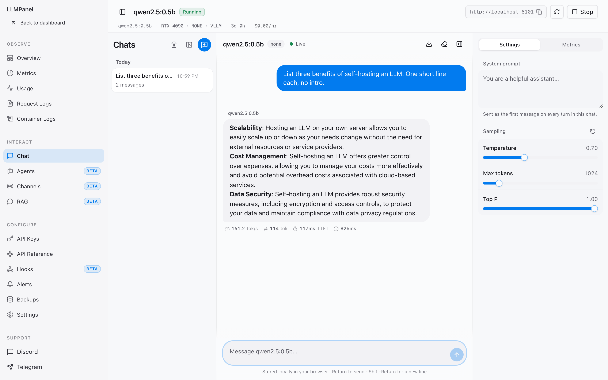

### See how it is used

Every request through the gateway is logged. The Usage page charts requests,
tokens, throughput, error rate and p50/p95/p99 latency over 24 hours to 90 days,
broken down per model and per API key, with CSV export.

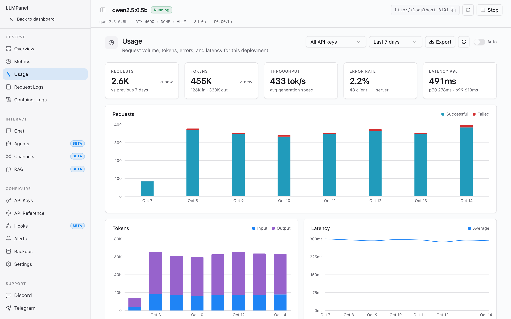

### Call it like OpenAI

Every deployment gets an API reference with ready-to-copy cURL, Python and
JavaScript snippets, and keys you can scope, rate-limit and revoke.

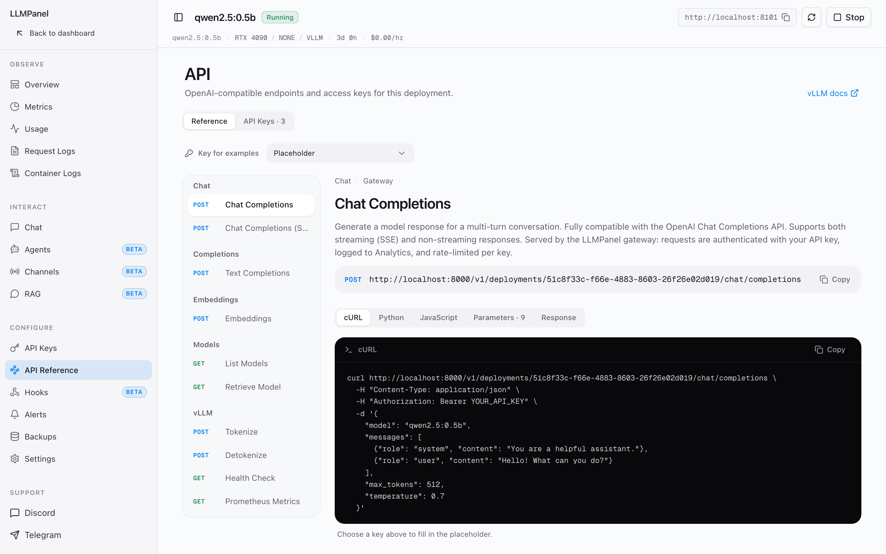

### Everything else

- **Providers.** The built-in **Local Docker** provider runs models on the host's
  NVIDIA GPUs and is added automatically on a self-hosted install. You can also
  connect your own **RunPod** or **Vast.ai** account. Lambda Cloud, TensorDock,
  DataCrunch, Hyperstack, Hot Aisle and Thunder Compute are listed as coming soon.
- **Engines.** vLLM by default (SGLang is available through the API), with
  fp16, int8, int4 and GGUF weights, multi-GPU tensor parallelism, prefix caching
  and speculative decoding.
- **OpenAI-compatible gateway** at `/v1`: chat completions, completions,
  embeddings, image generations and model listing. Call a deployment by path
  (`/v1/deployments/<id>/…`), let the gateway pick it from the request's `model`,
  or give each deployment its own hostname on your domain.
- **API keys** shown once and stored hashed, scoped to one deployment or all of
  them, with per-key scopes (chat, embeddings, images), requests-per-minute and
  per-day limits, expiry, and usage per key.
- **Per-GPU metrics** — utilisation, VRAM, temperature, power and clocks — from
  `nvidia-smi` on Local Docker and RunPod, plus token throughput from gateway
  traffic.
- **Image generation** with ten diffusion models (FLUX.1, SDXL, Stable Diffusion
  3.5, Qwen-Image and more) on Local Docker, behind `/v1/images/generations`,
  with an image playground.
- **Knowledge bases** <sup>beta</sup>: upload PDF, Markdown, text, CSV, JSON or
  HTML; chunk and embed it with a built-in model, one of your deployments, or any
  OpenAI-compatible embeddings API; store vectors locally or in Qdrant.
- **Agents** <sup>beta</sup>: a system prompt plus a `knowledge_search` tool over
  your knowledge bases, served at `/v1/agents/<id>/chat/completions`.
- **Channels** <sup>beta</sup>: put a deployment or an agent behind a Telegram,
  Discord, Slack or WhatsApp bot, with per-channel memory, allowlists and rate
  limits.
- **Alerts** to Telegram, Discord or Slack when a deployment starts, becomes
  ready, fails or stops.
- **Spend tracking** for cloud providers: burn rate, provider balances and cost
  history.
- **Backups**: per-deployment snapshots of agents, knowledge bases, keys, channels
  and alerts that you can download and restore, plus S3 backup for knowledge-base
  data.
- **Workspaces** with owner, member and viewer roles, email invitations, TOTP
  two-factor sign-in, optional GitHub and Google sign-in, and admin tools for
  managing users and sessions.

### More screenshots

<table>
  <tr>
    <td width="50%" valign="top">
      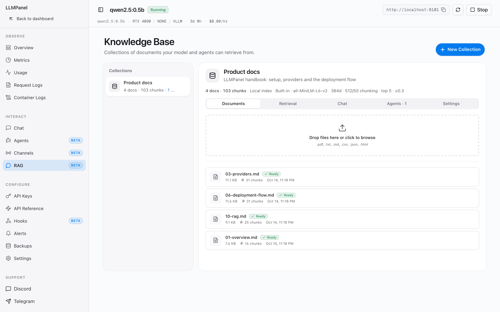
      <br><sub><b>Knowledge base</b> — upload documents; they are chunked and embedded with a built-in model.</sub>
    </td>
    <td width="50%" valign="top">
      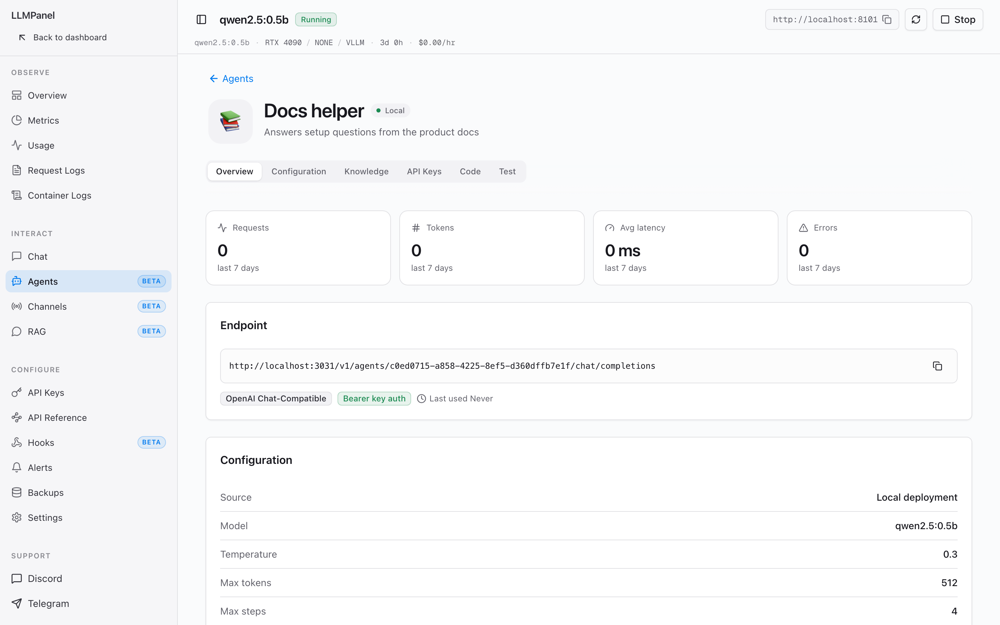
      <br><sub><b>Agent</b> — a system prompt plus knowledge search, served at its own <code>/v1/agents/…</code> endpoint.</sub>
    </td>
  </tr>
  <tr>
    <td width="50%" valign="top">
      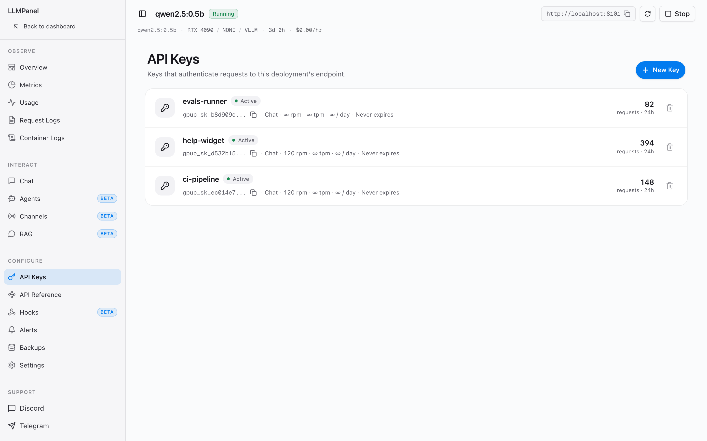
      <br><sub><b>API keys</b> — scopes, per-minute and per-day limits, expiry and usage per key.</sub>
    </td>
    <td width="50%" valign="top">
      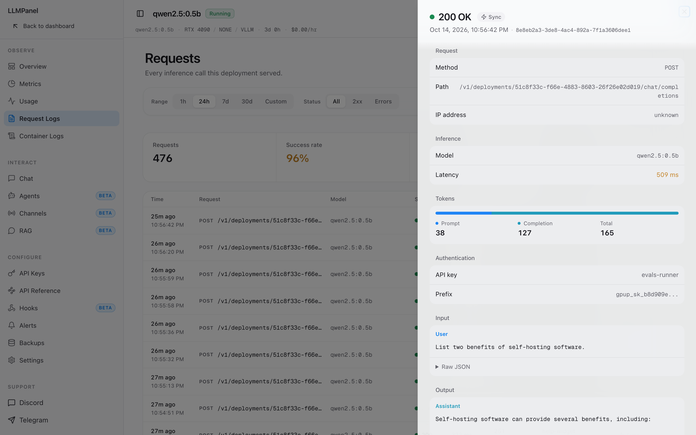
      <br><sub><b>Request logs</b> — every gateway call with latency, tokens, the key that made it, and the prompt and reply.</sub>
    </td>
  </tr>
  <tr>
    <td width="50%" valign="top">
      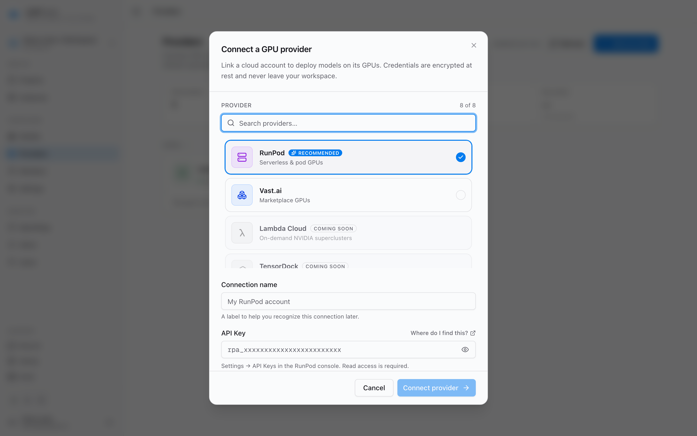
      <br><sub><b>Providers</b> — Local Docker is built in; connect RunPod or Vast.ai with your own key.</sub>
    </td>
    <td width="50%" valign="top">
      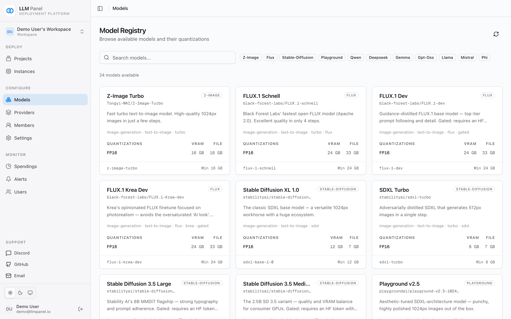
      <br><sub><b>Model registry</b> — LLMs and image models with VRAM needs per quantization.</sub>
    </td>
  </tr>
  <tr>
    <td width="50%" valign="top">
      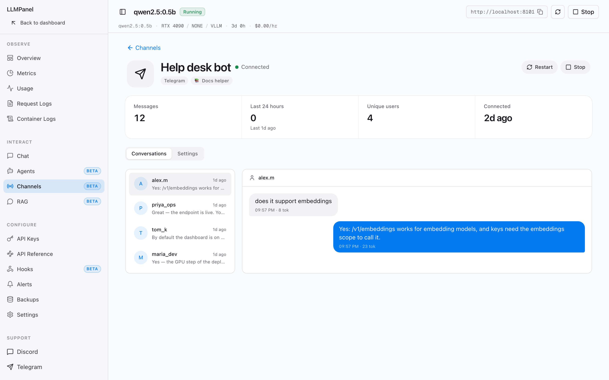
      <br><sub><b>Channels</b> — put a deployment or agent behind a Telegram, Discord, Slack or WhatsApp bot.</sub>
    </td>
    <td width="50%" valign="top">
      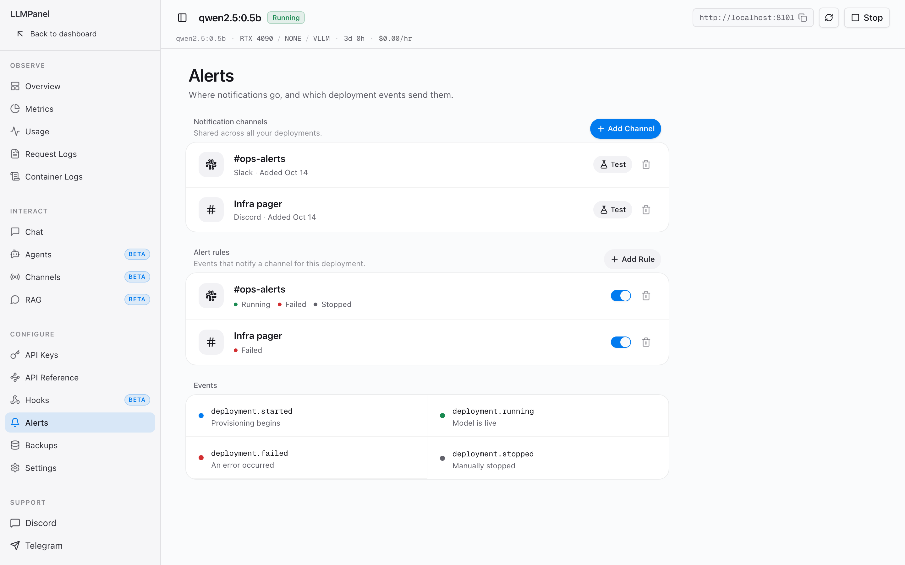
      <br><sub><b>Alerts</b> — notify Slack, Discord or Telegram when a deployment starts, goes live, fails or stops.</sub>
    </td>
  </tr>
</table>

## Getting started

### 1. Check the requirements

|                 |                                                                    |
| --------------- | ------------------------------------------------------------------ |
| Host            | Linux, with root. Docker is installed for you if it is missing.    |
| GPU (local)     | An NVIDIA GPU with drivers. The installer sets up the NVIDIA Container Toolkit on apt-based systems (Ubuntu, Debian). |
| GPU (cloud)     | A RunPod or Vast.ai API key instead — the panel itself then runs fine on a small CPU-only VPS. |
| Ports           | 3000 and 8000, or 80 and 443 when you install with a domain.       |

### 2. Install

```bash
curl -fsSL https://raw.githubusercontent.com/LLMPanel/llmpanel-oss/master/install.sh | sudo bash
```

The installer:

1. installs Docker and the Compose plugin if they are missing;
2. probes for an NVIDIA GPU and, if it finds one, enables GPU support;
3. writes `/data/llmpanel/.env` with freshly generated secrets (re-running keeps them);
4. pulls `ghcr.io/llmpanel/llmpanel-api` and `ghcr.io/llmpanel/llmpanel-web` and starts them.

The dashboard is then on `http://<your-server>:3000` and the API on
`http://<your-server>:8000`. For HTTPS on your own domain, see
[Install with a domain](#install-with-a-domain).

### 3. Create the admin account

Open the dashboard and register. **The first account becomes the instance
admin.** If an email provider is configured, you confirm the address with a
six-digit code.

### 4. Connect a GPU provider

On a self-hosted install the **Local Docker** provider is already there. To use
cloud GPUs instead, open **Providers** and add a RunPod or Vast.ai API key. Keys
are encrypted at rest.

### 5. Deploy a model

Click **New Project** and follow the four steps: provider, model, GPU, review. The
GPU step shows how much VRAM the model needs and whether the GPU you picked fits
it. The card on the dashboard follows provisioning live and turns green when the
health check passes.

For gated models such as Llama, set `HF_TOKEN` in `/data/llmpanel/.env` first.

### 6. Create an API key

Open the deployment, go to **API Keys** and create one. The key (`gpup_sk_…`) is
shown once — copy it. Keys get the `chat` scope by default; add `embeddings` or
`images` if you need them.

### 7. Call your endpoint

Any OpenAI client works. Point it at your API and use the model's Hugging Face ID
(or the deployment ID) as `model`:

```bash
export LLMPANEL_API=http://your-server:8000   # or https://api.example.com
export LLMPANEL_KEY=gpup_sk_your_key_here

curl "$LLMPANEL_API/v1/chat/completions" \
  -H "Authorization: Bearer $LLMPANEL_KEY" \
  -H "Content-Type: application/json" \
  -d '{"model": "Qwen/Qwen3-8B", "messages": [{"role": "user", "content": "Hello!"}]}'
```

```python
from openai import OpenAI

client = OpenAI(base_url="http://your-server:8000/v1", api_key="gpup_sk_your_key_here")
reply = client.chat.completions.create(
    model="Qwen/Qwen3-8B",
    messages=[{"role": "user", "content": "Hello!"}],
)
print(reply.choices[0].message.content)
```

The deployment's **API Reference** page has these snippets prefilled with its
exact URL, plus JavaScript and the vLLM extras (tokenize, health, Prometheus
metrics).

### 8. Watch it

**Usage** shows traffic by model and by key, **Request Logs** shows individual
requests, **Container Logs** streams the engine's output, and **Metrics** charts
GPU telemetry. Requests sent from the chat playground go straight to the model
and are not counted in Usage.

### Install with a domain

With no environment variables you get the plain-HTTP install above. For HTTPS
through Traefik and Let's Encrypt, pass your domains:

```bash
PANEL_DOMAIN=panel.example.com \
API_DOMAIN=api.example.com \
ACME_EMAIL=you@example.com \
BASE_DOMAIN=example.com \
CF_DNS_API_TOKEN=your-cloudflare-dns-token \
  curl -fsSL https://raw.githubusercontent.com/LLMPanel/llmpanel-oss/master/install.sh | sudo -E bash
```

- `PANEL_DOMAIN` and `ACME_EMAIL` are enough for HTTPS on the dashboard and API.
  `API_DOMAIN` defaults to `api.` plus the panel's parent domain.
- `BASE_DOMAIN` and `CF_DNS_API_TOKEN` are optional and go together: they give
  each deployment its own hostname (`qwen3-8b-ab12cd34.example.com`). That needs a
  `*.example.com` DNS record pointing at the host and a Cloudflare token with
  Zone:DNS:Edit, because Let's Encrypt issues wildcard certificates only over the
  DNS-01 challenge.

### Upgrade

```bash
cd /data/llmpanel && docker compose pull && docker compose up -d
```

Database migrations run automatically when the API starts.

## Configuration

The installer writes `/data/llmpanel/.env`; [`.env.example`](.env.example)
documents most options. The ones you are most likely to touch:

| Variable | Purpose |
| --- | --- |
| `LLMPANEL_VERSION` | Image tag to run: `latest` (default), a release such as `0.1.0`, or `edge` for the newest `master` build. |
| `HF_TOKEN` | Hugging Face token for gated models. |
| `PANEL_DOMAIN`, `API_DOMAIN`, `ACME_EMAIL` | HTTPS on your own domain. |
| `BASE_DOMAIN`, `CF_DNS_API_TOKEN` | Per-deployment hostnames with a wildcard certificate. |
| `KMS_URL`, `KMS_TOKEN` | Fetch the encryption key from a remote service instead of storing it on the host — see [Security](#security). |
| `GITHUB_CLIENT_ID`/`_SECRET`, `GOOGLE_CLIENT_ID`/`_SECRET` | Optional social sign-in. |
| `EMAIL_PROVIDER`, `RESEND_API_KEY`, `EMAIL_FROM` | Email for sign-up codes, password resets and invitations (Resend; Cloudflare Email is also supported). Without one, those flows stay off. |
| `DATABASE_URL`, `DATABASE_AUTH_TOKEN` | Use a hosted libSQL database (such as Turso) instead of the local SQLite file. |
| `MODEL_REGISTRY_URL` | Where the model catalogue comes from (default `https://registry.llmpanel.io`). |

After changing `.env`, apply it with `cd /data/llmpanel && docker compose up -d`.

## Before you expose it to the internet

- **Registration stays open after setup.** Anyone who can reach the dashboard
  can create an account, and on a self-hosted install every account can deploy
  to the host's GPUs. Keep the dashboard on a private network or VPN, or behind
  an authenticating proxy, unless you mean to offer it to others.
- **Local Docker model containers publish their own ports** on the host and
  serve without an API key — the key check happens in the LLMPanel gateway.
  Firewall those ports so that only the API can reach them, and send clients
  through `/v1`.

## Development

Requires Node 20.9+, pnpm 10 and Docker.

```bash
pnpm install

cat > apps/api/.env <<EOF
BETTER_AUTH_SECRET=$(openssl rand -hex 32)
ENCRYPTION_KEY=$(openssl rand -hex 32)
NEXT_PUBLIC_APP_URL=http://localhost:3000
BETTER_AUTH_BASE_URL=http://localhost:8000
EOF
echo "HONO_API_URL=http://localhost:8000" > apps/web/.env.local

pnpm dev        # dashboard on :3000, API on :8000
```

The API applies database migrations on every start, using `apps/api/local.db`
unless `DATABASE_URL` says otherwise. You don't need a GPU for most work: deploys
to Local Docker fail without one, but the dashboard, gateway and chat paths work
against any OpenAI-compatible server you already run.

After editing anything under `packages/db/src/schema/`, generate a migration:

```bash
pnpm --filter @llmpanel/db db:generate
```

Never run `drizzle-kit push` against a database the API will boot against. Push
changes the schema without recording it in the `__drizzle_migrations` ledger, so
the next start replays migrations that were already applied and fails with
`table ... already exists`.

Before opening a pull request, run `pnpm typecheck`, `pnpm lint` and `pnpm build` —
the same checks CI runs.

## Architecture

```
apps/
  web/        Next.js 16 dashboard (React 19, shadcn/ui, TanStack Query, Better Auth)
  api/        Hono API — Drizzle ORM, the OpenAI-compatible gateway, SSE for live status
packages/
  db/         Drizzle schema, migrations and connection (SQLite / libSQL)
  providers/  GPU provider abstraction — Local Docker, RunPod, Vast.ai and more
  shared/     Constants shared by both apps (roles, app name)
infra/
  kms-worker/ Optional Cloudflare Worker that holds the encryption key off-host
```

The API returns as soon as a deployment is created and provisions it in the
background; the dashboard follows progress over server-sent events. Deeper
documentation lives in [`docs/`](docs/), starting with
[`docs/01-overview.md`](docs/01-overview.md).

## Security

Provider credentials, bot tokens, alert-channel settings and other secrets are
encrypted at rest with AES-256-GCM, keyed by HKDF-SHA256 from `ENCRYPTION_KEY`,
and each ciphertext is bound to its database row. The API refuses to start in
production without a valid key. API keys are stored as SHA-256 hashes.

If you would rather the key never sat on the host, deploy
[`infra/kms-worker`](infra/kms-worker/) and set `KMS_URL` and `KMS_TOKEN`: the key
is then fetched at boot, held only in memory, and can be revoked.

To report a vulnerability, see [SECURITY.md](SECURITY.md). Please do not open a
public issue for one.

## Contributing

Contributions are welcome. See [CONTRIBUTING.md](CONTRIBUTING.md) for how this
repository is maintained — it is a mirror of a private monorepo, which changes the
workflow slightly — and what a good pull request looks like.

## License

[GNU AGPL v3](LICENSE).

You can run, modify and self-host LLMPanel freely, including commercially. If you
modify it and offer it to others over a network, the AGPL requires you to publish
your modified source. A managed service is available at
[llmpanel.io](https://llmpanel.io) for teams who would rather not host it.
